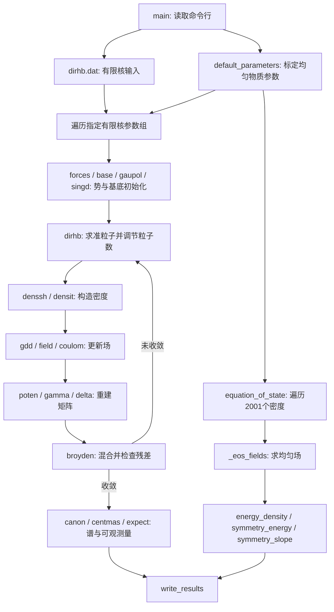

# CRMF / RHB 与核物质 EOS：从公式到 Python 计算

本文档解释当前 `crmf/` 的实际计算，而不只给出通用核物理公式。假设、变量符号、单位、推导过程、离散化和代码中的特殊约定分别说明。文档中的公式使用 LaTeX，建议在支持数学公式的 Markdown 预览中阅读。

## 1. 阅读顺序

1. 先读[按程序顺序推导一次完整计算](calculation_walkthrough.md)，了解输入、计算路径和输出。
2. [有限核 RHB 推导](finite_nucleus_rhb.md)：能量变分、Dirac-HFB 方程、密度、场方程、自洽迭代和可观测量。
3. [谐振子基底、配对与数值方法](basis_pairing_numerics.md)：基底、积分权重、有限程可分离配对和本征求解。
4. [核物质 EOS 推导](nuclear_matter_eos.md)：费米海积分、场方程、能量、压强、参数标定、对称能和斜率。

这些章节中的“标准理论关系”与“当前代码实际采用的公式”在存在差别时明确区分。数值回归一致不等于所有扩展分支都满足同一能量泛函的热力学恒等式。

## 2. 这个程序究竟算什么

程序有两条路径：

| 路径 | 物理体系 | 主要未知量 | 最终结果 |
|---|---|---|---|
| 球形有限核 | 有限的中子、质子体系，包含表面、库仑与配对 | 准粒子波函数、密度、介子场或点耦合势、配对场、粒子数化学势 | 每核子能量、半径、中子皮、自旋轨道能级差和谱 |
| 均匀核物质 | 零温、无限、平移不变的核子体系 | 给定密度下的均匀场和有效质量 | 每核子能量、场、对称能和对称能斜率 |

默认有限核是球形 Ca-48：$Z=20$、$N=28$。均匀 EOS 是对称核物质：$n_n=n_p=n_B/2$。EOS 的默认流程没有求解核子配对，也没有加入有限核的库仑、表面或质心修正。

包按物理域拆分后的目录、依赖边界和命令入口见[代码说明与架构](code_architecture.md)。入口是 [crmf/__main__.py](../crmf/__main__.py)，有限核总流程在 [crmf/finite_nucleus/nucleus.py](../crmf/finite_nucleus/nucleus.py) 的 `solve_nucleus()`，EOS 总流程在 [crmf/nuclear_matter/eos.py](../crmf/nuclear_matter/eos.py) 的 `equation_of_state()`，中子星 TOV 在 [crmf/neutron_star/tov.py](../crmf/neutron_star/tov.py)。计算 API 应从对应物理子包导入。

## 3. 两条路径共享的物理思想

核子之间的复杂相互作用被平均场替代。标量自能改变有效质量，矢量自能改变单粒子能量：

$$
h_D=c\boldsymbol\alpha\cdot\mathbf p
+\beta\left(mc^2+S_q(\mathbf r)\right)+V_q(\mathbf r),
\qquad q=n,p.
$$

对于均匀物质，波函数变成平面波，空间导数的本征值是动量，因此色散关系简化为

$$
E_q(k)=\sqrt{k^2+m_q^{*2}}+V_q,
\qquad m_q^*=m+S_q.
$$

这里后一式使用 $c=1$，动量、质量和能量同单位。有限核需要逐个求解轨道，均匀物质则可对占满到 $k_{Fq}$ 的动量球积分。两者都是“场与密度相互决定”，只是空间表示不同。

### 3.1 为什么会出现自洽循环

设能量是正常密度 $\rho$ 和配对张量 $\kappa$ 的泛函：

$$
E=E[\rho,\kappa,\kappa^*].
$$

保持中子数、质子数的约束变分给出

$$
\delta\left(E-\lambda_nN-\lambda_pZ\right)=0,
\qquad
h=\frac{\delta E}{\delta\rho},
\qquad
\Delta\ \text{由}\ \frac{\delta E}{\delta\kappa^*}\ \text{确定}.
$$

配对导数前的 $1/2$ 因子取决于是否把反对称指标和时间反演简并重复计数；章节中的配对矩阵公式采用当前代码的明确约定。

在当前实数、时间反演基底下，准粒子方程写为

$$
\begin{pmatrix}
h-\lambda & \Delta\\
\Delta & -h+\lambda
\end{pmatrix}
\begin{pmatrix}U_\mu\\V_\mu\end{pmatrix}
=E_\mu\begin{pmatrix}U_\mu\\V_\mu\end{pmatrix}.
$$

解得到的 $U,V$ 又产生

$$
\rho_{ab}=\sum_\mu V_{a\mu}V_{b\mu}^*,
\qquad
\kappa_{ab}=\sum_\mu V_{a\mu}U_{b\mu}^*.
$$

新的密度更新 $h$ 和 $\Delta$，所以不能只对角化一次。只有输入势和由输出密度重建的势一致，才得到自洽解。有限核章节还解释实际选取的准粒子分支、磁简并系数和负能量基底，不能把上式中的求和理解成毫无选择地遍历全部本征向量。

### 3.2 对应到程序的流程



`--nucleus-only` 和 `--eos-only` 分别选择其中一条输出路径。自洽迭代内部也计算能量作进度记录，收敛后的 `canon()`、`centmas()`、`expect()` 才形成最终有限核结果。

## 4. 输入和参数不能混淆

当前 `dirhb.dat` 的关键输入是：

| 输入 | 当前值 | 含义 |
|---|---|---|
| 核 | Ca-48 | 中子数28、质子数20 |
| `n0f, n0b` | 20, 30 | 费米子与介子谐振子基底截断 |
| `inin, inink` | 1, 1 | 新建初始平均场与配对场；0表示读取重启记录 |
| 初始中子/质子 gap | 1.0, 1.0 MeV | 初值，不是锁定的最终配对能隙 |
| `Force` | FSU-dlt67 | 被 `NucleusConfig` 读入的参数组名称 |

**默认命令行实际计算 `new1` 到 `new5`。** `main()` 的 `--models` 默认列表会覆盖输入 `Force`，要算输入中的那组，应显式写 `--models FSU-dlt67`。直接调用 `solve_nucleus(config)` 的默认 `model` 也是 `new1`。

EOS 默认参数另由饱和性质标定：

$$
n_0=0.148\ \mathrm{fm}^{-3},\quad
e_0=-16.31\ \mathrm{MeV},\quad
K_0=229.2\ \mathrm{MeV},\quad m^*/m=0.610,
$$

$$
S_0=32.53\ \mathrm{MeV},\qquad L_0=48.21\ \mathrm{MeV}.
$$

EOS 固定 $g_\delta=6.2$、$c_\omega=0.0052834$、$c_{\delta\sigma}=0.054$ 等参数，再标定其余耦合；具体方程见 EOS 章节。它不是把五个有限核参数组分别生成五张 EOS。只有有限核使用 `--models EOS` 时，`forces()` 才把这套标定参数映射到有限核求解器。

## 5. 单位与符号总表

| 量 | 有限核 | 均匀物质 EOS |
|---|---|---|
| 长度、密度 | fm、fm$^{-3}$ | fm、fm$^{-3}$ |
| 能量、势、配对 gap | MeV | 内部 GeV；输出部分转换为 MeV |
| 质量参数 | state 中除以 $\hbar c$，单位 fm$^{-1}$ | GeV |
| $\hbar c$ | `hbc=197.328284` MeV fm | `HBAR` 约0.197328284 GeV fm |
| 场存储 | `phi` 是归一化场，单位 fm$^{-3}$；乘 `ggmes` 后成为自能 fm$^{-1}$ | $F_i$ 单位 $\sqrt{\mathrm{fm}^{-3}/\mathrm{GeV}}$ |
| 场到能量 | `glt*hbc` | $g_iF_i(\hbar c)^{3/2}$ |

全篇使用 $\tau_n=-1$、$\tau_p=+1$，与有限核通道 $\rho_3=\rho_p-\rho_n$ 一致；EOS 的不对称度是 $\alpha=(n_n-n_p)/n_B$，所以 $n_p-n_n=-\alpha n_B$。标量场 $\sigma$ 和对称能常用的符号 $S(n)$ 不要混淆。

代码有限核哈密顿量已经减去核子静质量，输出每核子能量为负的结合能约定。因此 `Ca_results.txt` 的 $-8.64448$ MeV 对应常用正结合能 $B/A=+8.64448$ MeV。

## 6. 用已有数值检查公式

当前 [output/results.json](../output/results.json) 的 Ca-48 `new1` 结果为：

$$
r_n=3.5622928887\ \mathrm{fm},\qquad
r_p=3.3983240347\ \mathrm{fm}.
$$

由定义直接推得

$$
r_m=\sqrt{\frac{Nr_n^2+Zr_p^2}{A}}
=3.4949075524\ \mathrm{fm},
$$

$$
r_{\mathrm{ch}}=\sqrt{r_p^2+0.64\ \mathrm{fm}^2}
=3.4912184470\ \mathrm{fm},
\qquad
\Delta r_{np}=r_n-r_p=0.1639688539\ \mathrm{fm}.
$$

同一组结果的 $E/A=-8.6444796461$ MeV，故静质量扣除后的总能量为

$$
E=48(-8.6444796461)=-414.9350230127\ \mathrm{MeV}.
$$

该存档解迭代30次，混合残差 `si` 约 $4.40\times10^{-7}$。这只是所混合变量的最大差值，不能解读为所有物理方程或能量恒等式的无量纲误差。

对 EOS 默认参数，用 `solve_fields()` 的高精度场解在 $n_0$ 检查得到

$$
e\simeq-16.309988\ \mathrm{MeV},\quad
K\simeq229.199997\ \mathrm{MeV},\quad
S\simeq32.529999\ \mathrm{MeV},\quad
L\simeq48.209999\ \mathrm{MeV}.
$$

取 $\delta n=10^{-5}\ \mathrm{fm}^{-3}$，在 $n_0\pm\delta n$ 各自重求场，差分式

$$
L_{\mathrm{FD}}=3n_0\frac{S(n_0+\delta n)-S(n_0-\delta n)}{2\delta n}
\simeq48.210001\ \mathrm{MeV}
$$

与解析表达式一致。这里必须在两侧重新求场，不能固定 $m^*$ 后只对费米动量求导。

生成 `EOS.OUT` 时调用的是保留早停阈值的 `_eos_fields()`，而不是上述高精度 `solve_fields()`。表格在饱和密度附近的能量约为 $-16.30828$ MeV，二者约 $0.0017$ MeV 的差异来自求解精度路径；EOS 章节给出明确解释。

## 7. 阅读公式时需要知道的实现边界

- 球形、时间反演对称的 Hartree 平均场是当前有限核计算的前提；没有计算形变、有限温度或显式 Fock 交换。
- `Selfconsistency Test` 是保留的能量诊断，当前写法遗漏部分项；它并不是停止自洽迭代的判据。实际停止判据是 `si < tolerance`。
- `DD-ME2` 分支准备了参数，但当前 `gdd()` 对介子分支采用常耦合；不能仅根据参数组名称声称运行完整标准 DD-ME2 密度依赖模型。
- EOS 不对称物质的当前压强交叉项系数与能量、场方程的热力学关系存在差异；不能把该扩展分支的结果直接当作已验证一致的热力学 EOS。
- 重启文件由 Python 读写。测试夹具是数值参考，不参加实际物理解的生成。

以上边界在对应推导章节逐项对应代码，不对当前数值算法作修改。

## 8. 运行和代码导航

```powershell
# 当前目录中的 Ca-48，计算五组有限核与默认 EOS
python -m crmf --input dirhb.dat --output output

# 单独计算 EOS，然后绘图
python -m crmf --eos-only --output output
python examples/plot_eos.py --input output/EOS.OUT --output output/eos

# 单组有限核的逐步迭代
python -m crmf --models new1 --nucleus-only --verbose --output output

# 数值回归检查
python -m unittest discover -s tests -v
```

CLI 未指定 `--output` 时默认是 `python_output/`；这里显式使用 `output/`，与当前保存的结果目录一致。

| 模块 | 读代码时应重点看什么 |
|---|---|
| [state.py](../crmf/finite_nucleus/state.py) | `NucleusConfig` 输入、维度和存储 |
| [finite_setup.py](../crmf/finite_nucleus/finite_setup.py) | 参数组、单位、初始势、基底和传播子 |
| [pairing.py](../crmf/finite_nucleus/pairing.py) | 配对基变换、角动量耦合和可分离矩阵 |
| [eigensolver.py](../crmf/math_utils/eigensolver.py) | 实对称本征问题及停止精度 |
| [finite_solver.py](../crmf/finite_nucleus/finite_solver.py) | RHB、场、混合、能量和半径 |
| [nucleus.py](../crmf/finite_nucleus/nucleus.py) | 自洽总流程、可选约束单极响应 |
| [eos.py](../crmf/nuclear_matter/eos.py) | 费米积分、场、耦合标定、EOS和核物质响应 |
| [io.py](../crmf/finite_nucleus/io.py) | 输出列、谱、密度曲线和重启记录 |

## 9. 复算文档公式

可以运行[公式核对脚本](verify_derivation.py)：

```powershell
python docs/verify_derivation.py
```

脚本用直接数值积分核对费米海与配对高斯积分，用差分核对对称能、斜率和不可压缩响应，并核对存档有限核的半径关系。它不重新执行完整有限核自洽计算，也不覆盖计算结果；检查记录写入 `output/derivation_checks.json`。有限核存档优先读取 `output/results.json`，没有该文件时读取 `python_output/results.json`；可用 `--results` 指定其他文件。

文档按当前 Python 实现编写；若改变能量泛函、符号或单位，需同时检查场方程、观测量、数值测试及对应推导。
