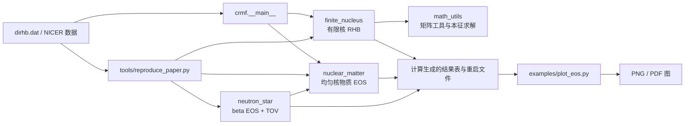

# 代码说明与架构

本项目按物理问题和通用数值工具分成四个计算域。公式推导仍集中在[有限核 RHB](finite_nucleus_rhb.md)、[核物质 EOS](nuclear_matter_eos.md)和[数值方法](basis_pairing_numerics.md)；本文说明代码模块、调用关系、单位和入口。

## 目录结构

```text
CRMFdlt/
|-- crmf/
|   |-- __init__.py           包元数据与版本号
|   |-- finite_nucleus/       球形有限核 RHB/CRMF
|   |   |-- state.py          输入配置与工作数组
|   |   |-- finite_setup.py   相互作用、网格、基底、Green 函数初始化
|   |   |-- finite_solver.py  Dirac-HFB、密度、场、自洽迭代和可观测量
|   |   |-- pairing.py        Talmi-Moshinsky 变换与可分离配对
|   |   |-- io.py             重启文件、报告、密度和结果输出
|   |   |-- nucleus.py        有限核高层计算流程
|   |   `-- numerics.py       球形 Dirac 基底量子数辅助函数
|   |-- nuclear_matter/
|   |   |-- eos.py            RMF 均匀物质场、能量、压强、饱和标定
|   |   |                   与 beta 平衡物质
|   |-- neutron_star/
|   |   `-- tov.py            beta 平衡核心 EOS、crust 匹配和 TOV 积分
|   |-- math_utils/
|   |   |-- arrays.py         Fortran 打包矩阵视图和对称化
|   |   `-- eigensolver.py    SDIAG Householder + QR 实现
|   |-- __main__.py           `python -m crmf` CLI
|-- examples/
|   `-- plot_eos.py           读取已生成 EOS 表并绘图，不运行物理求解
|-- tools/
|   |-- reproduce_paper.py    论文结果计算与图表生成
|   `-- derive_nicer_contours.py 从公开后验样本重建 NICER 轮廓数据
|-- tests/                    数值回归测试与参考数据
|-- data/                     绘图使用的公开/派生数据
`-- docs/                     推导、代码导读和核验脚本
```

## 模块关系



层次约束：有限核模块负责自洽 RHB；核物质模块提供均匀物质态方程和组分；中子星模块只负责把 beta 平衡 EOS 转为 TOV 可用的 $P(\epsilon)$ 并积分恒星结构。绘图脚本不持有新的物理求解实现。通用数组与本征求解代码集中在 `math_utils`，不依赖具体的核物理模型。

## 计算流程

有限核路径由 `NucleusConfig` 读入核素、壳层数和迭代设置。`finite_setup` 建径向 Gaussian mesh、谐振子基底与场 Green 矩阵；`finite_solver` 依次解准粒子方程、生成密度、更新介子/点耦合场，并以 Broyden 混合直至

$$
s_i=\max_i|X_i^{\mathrm{out}}-X_i^{\mathrm{in}}|<\varepsilon.
$$

收敛后由 canonical 轨道、质心修正和球对称积分得到总能量、均方根半径及能级差。重要量的单位为 MeV 和 fm；场存储及部分中间量沿用源程序自然单位，转换位置在对应函数中注明。

均匀核物质路径按给定 $n$ 和不对称度 $\alpha=(n_n-n_p)/n$ 解 $\sigma,\omega,\rho,\delta$ 场方程，再计算 $\epsilon$、每核子能量、压强、对称能 $S$ 和斜率 $L=3n\,dS/dn$。`equation_of_state()` 默认输出 2001 点对称物质表；密度单位是 fm$^{-3}$，场和能量列的约定见该函数 docstring 及[nuclear_matter_eos.md](nuclear_matter_eos.md)。

中子星路径先满足

$$
\mu_n-\mu_p=\mu_e=\mu_\mu,\qquad n_p=n_e+n_\mu,
$$

并以 $P=n\mu_n-\epsilon$ 构造 beta 平衡核心 EOS。低密度端接上多方 crust，然后在 $G=c=1$ 下积分

$$
\frac{dm}{dr}=4\pi r^2\epsilon,\qquad
\frac{dP}{dr}=-\frac{(\epsilon+P)(m+4\pi r^3P)}{r(r-2m)}.
$$

EOS 能量密度和压强输入 TOV 前由 MeV fm$^{-3}$ 换算为 km$^{-2}$；函数返回半径 km、质量 $M_\odot$。

## API 与命令

```python
from crmf.finite_nucleus import NucleusConfig, solve_nucleus
from crmf.nuclear_matter import default_parameters, equation_of_state, solve_fields
from crmf.neutron_star import build_beta_equilibrium_eos, integrate_star, make_crust

config = NucleusConfig.from_file("dirhb.dat")
state = solve_nucleus(config, "FSU-dlt67")
table = equation_of_state(default_parameters())
fields = solve_fields(0.148, asymmetry=0.2)
```

```powershell
python -m crmf --models new1 --nucleus-only
python -m crmf --eos-only
python -m tools.reproduce_paper --skip-finite
python examples/plot_eos.py --input output/EOS.OUT
python -m unittest discover -s tests -v
python docs/verify_derivation.py
```

## 入口说明

计算 API 按上面的四个子包组织。命令行使用 `python -m crmf`；`tools/reproduce_paper.py` 负责论文复现计算和图表生成。`examples/` 中的脚本只读取现有数值表并绘图。

## 公式注释约定

Python 计算模块的函数 docstring 用中文说明用途、参数/单位、返回值，并在关键物理计算处使用 Markdown `$$...$$` 数学块或行内 LaTeX。含反斜杠公式的 docstring 使用 `r"""..."""`，避免 Python 将 `\n`、`\t` 等解释为转义字符。实现约定与源程序存在已知差异时，应把差异写在相应 docstring，而不是在文档中用理想公式替换实际代码。
